# Terraria-Rust

A native reimplementation of Terraria 1.4.5.8 in Rust with a Vulkan renderer, built from a
clean-room analysis of the decompiled C# game.

> **Status: milestone 4 — first enemy.** The world renders with the game's own lighting,
> liquids, trees, sky layers and rain; a player with gravity, collision and a following
> camera can walk, jump, swim, mine, place starter blocks, fight hopping slimes and
> respawn on death. The full NPC roster, projectiles, items/UI and networking are not
> implemented. See [`docs/ROADMAP.md`](docs/ROADMAP.md) for the honest plan.

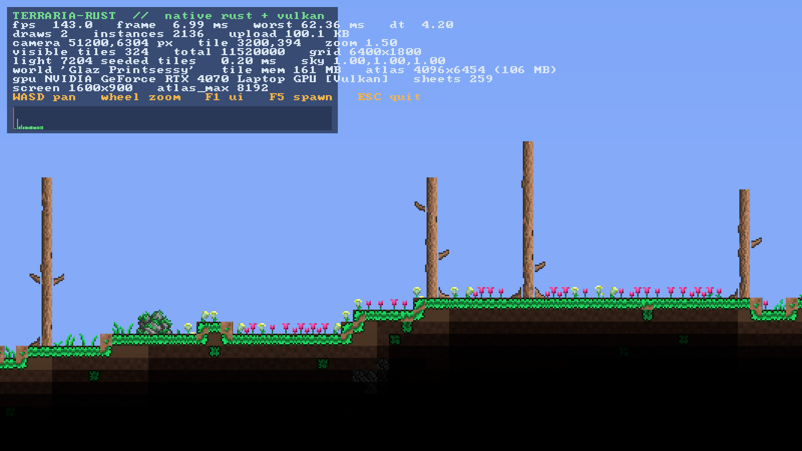

| | |
| --- | --- |
| 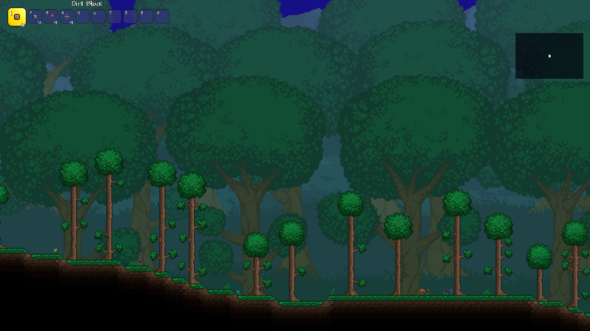 | 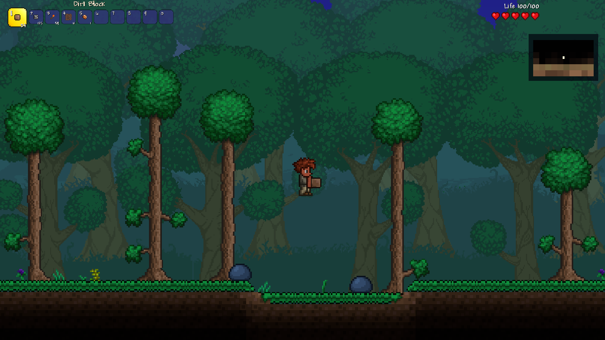 |
| A world from our own generator (seed 1) | The player, walking on the generated surface |
| 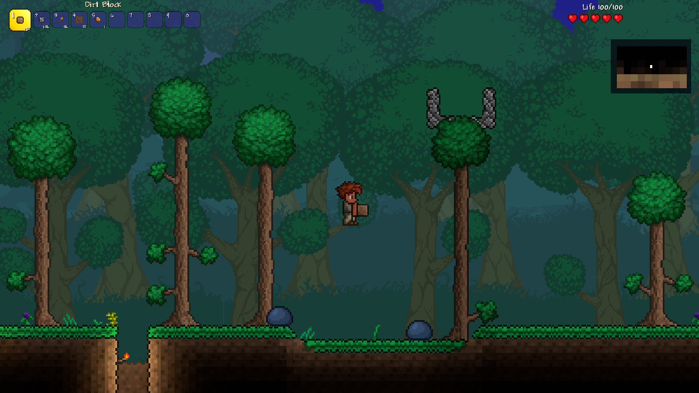 | 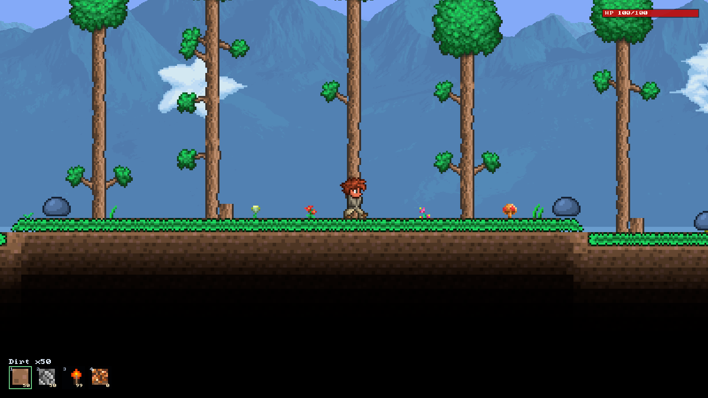 |
| Mining/placing with the hotbar and local re-framing | First enemy pass: hopping slimes and the health bar |
| 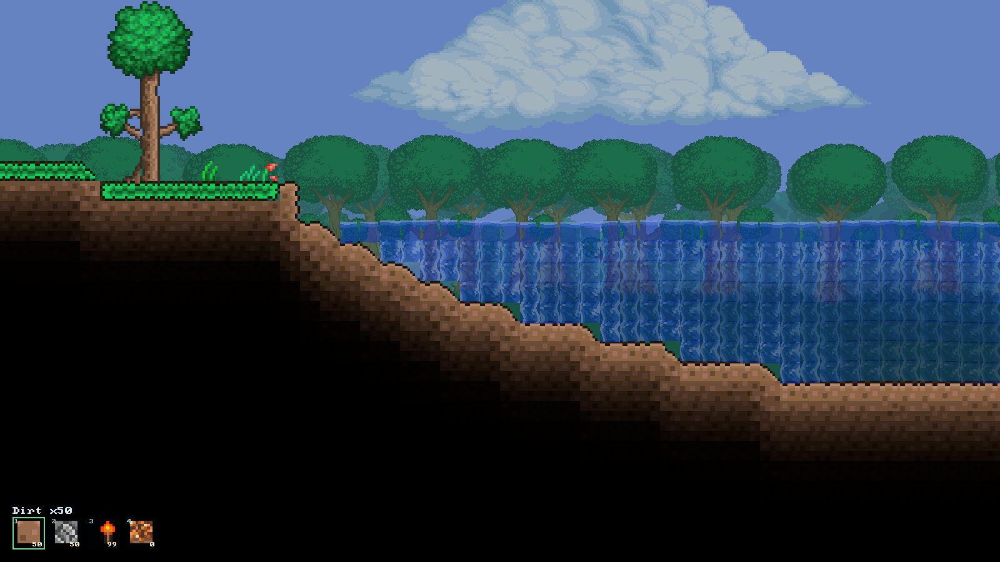 | 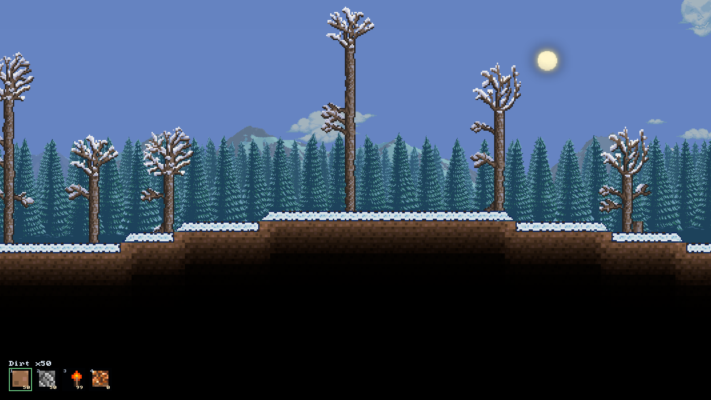 |
| Generated forest lake: animated water, waves, depth tint | Snow biome: snow tiles, winter trees, pine background |
| 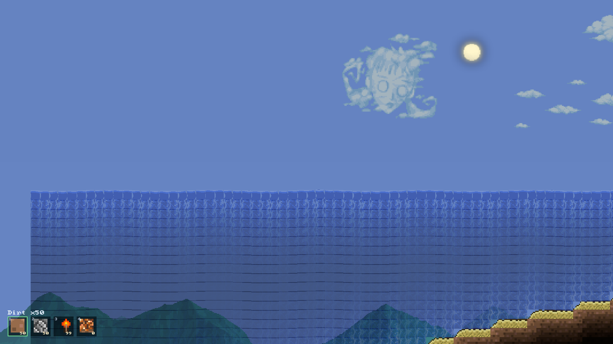 | 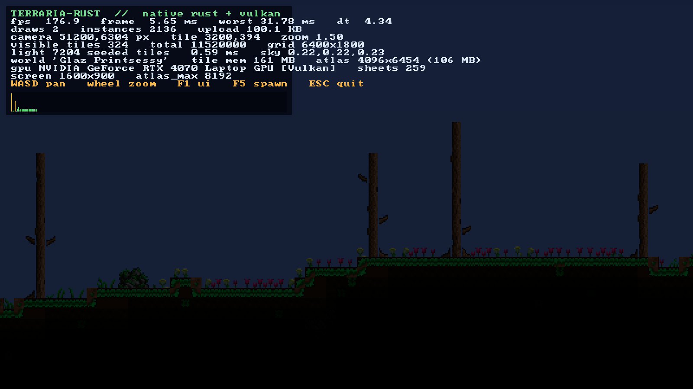 |
| Ocean beach at the world edge | Night: moon, stars, parallax mountains |
| 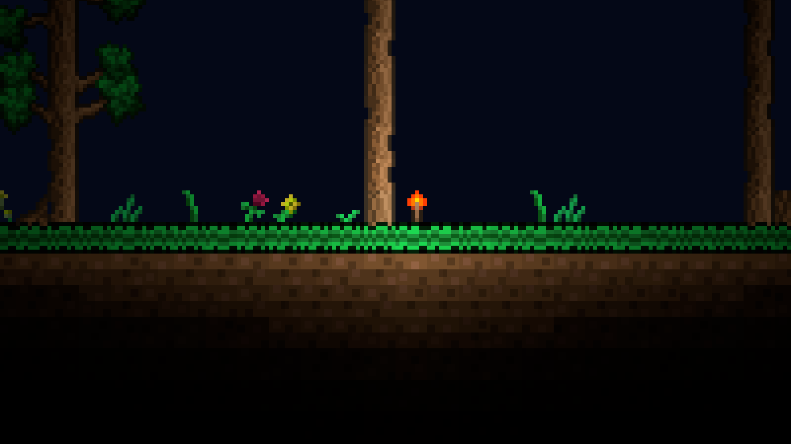 | 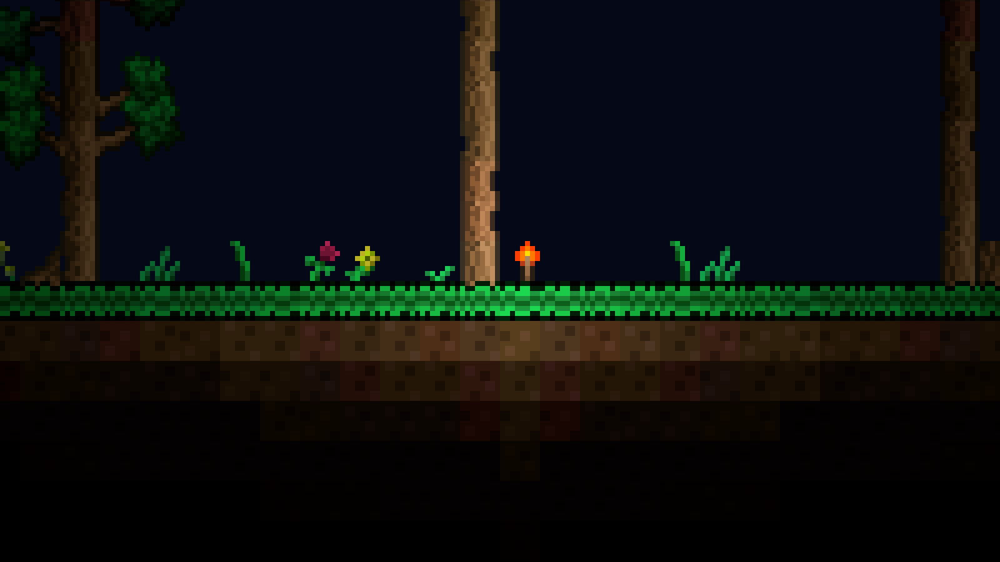 |
| Color mode: 9-sliced block light, smooth edges | Retro mode: flat per-tile legacy lighting |

| | |
| --- | --- |
| 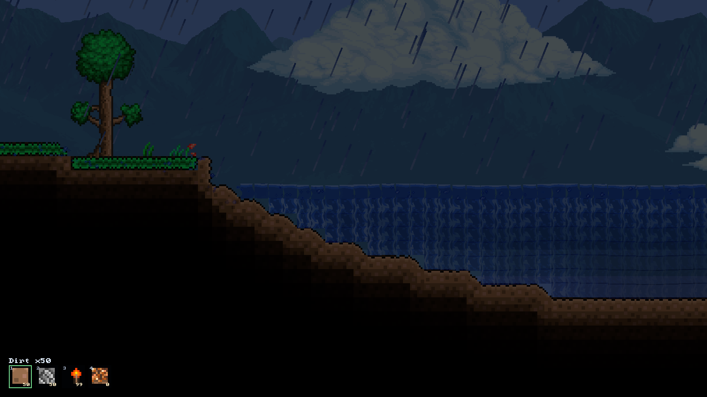 | 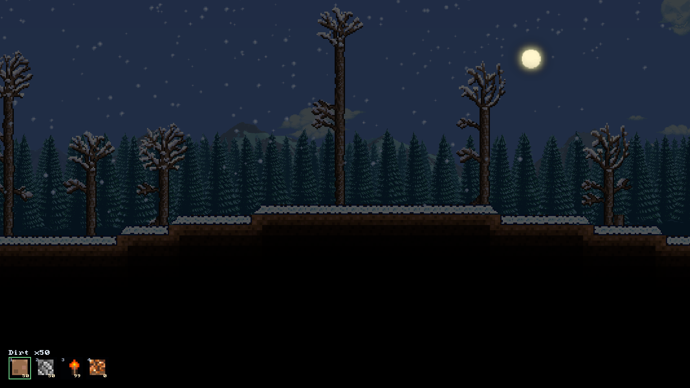 |
| Rain: slanted `Rain_0` drops, splashes, overcast sunlight | Snowfall: `Dust` snowflakes in the snow biome |

Weather is a port of `Rain.MakeRain`/`Rain.Update`/`Main.DrawRain`: slanted 2×40 drops lit
by the local light map, ground and water splashes, and `SetBackColor`'s overcast dimming of
the sky and surface sunlight. In a snow biome the drops are replaced by ambient `Dust`
snowflakes that thicken during a storm.

## What works right now

- **World generation** — a native, deterministic generator modelled on `WorldGen`'s passes:
  height-noise surface with a spawn plateau, grass/dirt/stone layers, hill slopes, caves,
  dirt/stone walls, ore blobs (copper/iron/silver/gold), ash-and-hellstone underworld,
  common trees with canopies and branches, grass/flowers on the surface, a forest lake with
  water, lava puddles, ocean beaches at both edges and a **snow biome** in the eastern third
  (snow tiles, winter trees, pine background). A 4200×1200 world generates in ~165 ms. Re-running with `TR_REGEN=1` and `TR_SEED=<n>` gives a new
  world.
- **Native saves** — `Documents/My Games/Terrustaria/Worlds/Terrustaria.trwld`, a compact
  RLE row format that round-trips every tile field. The app loads it on the next start. The
  original `.wld` loader is still available when a path is passed.
- **World loading** — native `.wld` parser (format versions ≥ 87, section table, RLE tile
  section, header metadata). A 6400×1800 world with 11.5 M tiles loads in ~60 ms.
- **Autotiling** — block frames from a port of `WorldGen.TileFrameCosmetic` (generic frame
  chain + merge families + 2 228 merge pairs extracted from the decompiled source) and wall
  frames from `Framing.WallFrame` (full 20×3 lookup). Sloped and half-brick tiles are now
  framed and drawn with the original's 2 px slice geometry (`DrawBasicTile`); 172 k slopes
  in the reference world render as diagonal terrain instead of stairs.
- **Trees** — `TileDrawing.DrawTrees` composition: 20×20 trunks on the 22 px `Tiles_5`
  grid, biome sheet sections, `Tree_Tops_*` canopies and `Tree_Branches_*` branches anchored
  to the invisible marker frames, with the original offsets and variants.
- **Lighting** — a port of `TileLightScanner` (surface / hell / wall / emissive / liquid
  seeds) and `LightMap.Blur` (2 passes × 4 directional sweeps, `0.91` air / `0.56` solid
  decay, `0.0185` cutoff) over the visible rect inflated by 28 tiles. Surface light now
  seeds up to each column's own first solid tile, so hills and valleys are lit like the
  original. Daylight (`Main.SetBackColor` → `ApplyColorOfTheSkiesToTiles`) and
  `GlobalBrightness = 1.2` are applied. `Color`/`White` modes use `Lighting.GetColor9Slice`
  /`GetColor4Slice` block slicing for smooth seams; `Retro` and `Trippy` use the flat legacy
  path. `F2` cycles the four modes, `TR_LIGHT_MODE` pins one. Seeding and horizontal sweeps
  run on Rayon, and the finished map is cached, so a static view costs 0 ms.
- **Liquids** — `LiquidRenderer` drawing plus a port of `Liquid.UpdateLiquid`/`Liquid.Update`:
  water, lava, honey and shimmer are drawn from the original `Misc/water_*` textures with
  16-frame animation, per-liquid opacity, per-column surface waves, a shader UV ripple and
  a depth tint, lit by the same light map so lava glows. A bounded active-cell list is
  pumped at 30 Hz; cells fall and level out with the original six-neighbour rules and
  retire after eight quiet passes, so a breached lake drains and waterfalls form falling
  columns. Breaking or placing a block wakes the surrounding liquid. The generator fills a
  forest lake and puts lava puddles on cave floors. Still missing: the `Waterfall_*` overlay
  at half-brick spouts, the four-corner shoreline mesh, water styles and shimmer sparkles.
- **Rain & weather** — `rain.rs` follows `Rain.MakeRain`/`Rain.Update`/`Main.DrawRain`:
  `cloudAlpha` ramps toward a `maxRaining` target, up to 750 rotated `Rain_0` drops fall at
  the original `(wind*18, 14)` px/tick, spawn only in wall-free sky and die on solid or wet
  tiles with a `Dust` splash. `SetBackColor`'s `1 - cloudAlpha*0.9` dims the sky, clouds and
  surface sunlight. In a snow biome the same event becomes snowfall: no rain drops, and
  ambient `Dust` type-76 flakes (thicker, faster and more wind-blown with intensity) drift
  down. `TR_RAIN=<0..1.75>` pins a storm; the scheduler is disabled with `TR_NO_WEATHER`.
- **Sky & background** — `Background_0` gradient anchored to `Main.worldSurface`, then the
  vanilla `DrawSurfaceBG` layering: forest far/near mountains (`Background_7`/`8`) with the
  three `Background_50..52` foreground tree lines, snow mountains (`35`/`36`) with the
  `37..39` pine line, and the ocean `Background_28` sea horizon with islands. Layers use
  `backgroundTopMagicNumber`'s vertical parallax, per-layer scale/parallax and the mirrored
  middle tree layer; each texture's painted ground band is measured so the skyline sits on
  the horizon. Sun/moon, twinkling stars, the 15/9-minute clock, deterministic `Cloud_*`
  clouds and the per-column underground fade remain. Corruption/crimson/jungle/hallow
  variants and the textured underground backgrounds are still to come.
- **Asset pipeline** — `tools/XnbExtract` decompresses the game's XNA v5 `.xnb` containers
  (LZX) and writes PNGs. 13 993 textures extracted, 15 100 of 15 123 files OK. The world's
  sheets plus all tree canopy/branch styles and the 42 `Cloud_*` textures are decoded in
  parallel.
- **Atlas** — all sheets used by the current world (plus tree/cloud/sky/player sheets) are
  shelf-packed into one 8192×3031 texture for the generated world (99 MB), nearest
  filtering, no mipmaps. The original world needs 8192×4590 (150 MB).
- **Renderer** — wgpu 30 on the **Vulkan** backend, one instanced-quad pipeline, one atlas,
  1–2 draw calls per frame (world + optional UI), ~2 200–3 600 instances for a 1600×900
  viewport at the gameplay zoom range.
- **Debug overlay** — FPS, frame graph, draw calls, instance/quad/foliage counts, upload
  size, camera state, tile counts, light-seeded tiles and light-map time, culling counters,
  memory, GPU/driver info, active light mode.
- **Culling** — 64×64 chunk occupancy skips empty areas; walls under fully opaque blocks
  are not emitted; fully dark cells whose content is opaque collapse into greedy black
  rectangles. All of it is pixel-identical to drawing every tile. When the camera, zoom,
  screen, ambient light, light mode and world revision are all unchanged, the whole world
  instance range is reused (G6) and only the UI is rebuilt.
- **Player (first pass)** — a 20×42 hitbox with the original `Player.cs` movement constants:
  gravity, acceleration/friction, jump, 1-tile auto-step, axis-separated AABB collision,
  simple water buoyancy, ground-slope support and respawn. Survival follows `Player.cs`:
  a 200-tick breath meter that drains underwater (2 damage per 7 ticks once empty, with a
  HUD bar), fall damage after 25 tiles (10 per extra tile), lava damage and out-of-combat
  regeneration (5 s delay, 1 HP per 0.5 s). The starter character is composed from the
  original `Player_0_*`/`Player_Hair_1` part strips (head, eyes, torso, shirt, arms, legs,
  pants, shoes, hair) with walk/jump leg frames and camera follow. Half bricks and ceiling
  slopes still count as full cells; the full draw-layer order is still to port.
- **NPCs & combat (first pass)** — blue slimes spawn on the surface near the player, hop
  toward them with gravity/collision, deal 12 contact damage and have 30 HP; at night a
  flying demon eye with 25 HP chases the player (14 damage). LMB over an
  NPC within four tiles performs a 15-damage melee hit with a short cooldown; damaged
  slimes show an overhead bar. The player has 100 HP, hurt cooldown/knockback, a HUD health
  bar and respawns at spawn on death. At most four slimes are kept alive and respawned.
- **Editing & hotbar (first pass)** — LMB mines (0.25 s dirt / 0.55 s stone+ore), RMB
  places the selected block, 1–4 select Dirt/Stone/Torch/Copper, mined blocks go into the
  hotbar counts, and F9 (or closing the window) writes the world back to `.trwld` plus the
  player state to a `.trplayer` sidecar (position, HP and slot counts). Edits
  bump the world revision, update the column surface, re-frame the 5×5 neighbourhood and
  invalidate the light/instance caches. No item entities, tools, reach-through-walls or
  chests yet.
- **Camera** — follows the player (WASD/arrows move, Space/W/Up jump, wheel zoom, F1 debug,
  F2 light mode, F5 respawn). `TR_CAM`/`TR_PAN` switch to the free debug camera; `TR_NOPLAYER`
  hides the player for pixel comparisons.
- **Headless tooling** — `TR_BENCH` (uncapped frame timing), `TR_SHOT` (deterministic
  screenshot without desktop capture), `TR_CAM`/`TR_ZOOM`, `TR_DAY`, `TR_LIGHT_MODE`,
  `TR_RAIN`,
  `TR_LIGHT_AT`, `TR_SCAN_LIGHT`, `TR_ATLAS_DUMP`, `TR_STATS`, `TR_NOCACHE`, `TR_NO_BG`,
  `TR_NO_WALLS`, `TR_REGEN`, `TR_SEED`, `TR_PAN` and `tools/pixel_diff.py`.

## Measured (RTX 4070 Laptop, Ryzen AI 9 365, 1600×900)

| Metric | Value |
| --- | --- |
| Frame time, avg (generated surface, zoom 1.5, overlay off) | **2.00 ms** (p50 1.88) |
| Frame time, avg (original surface, zoom 1.5, overlay off) | **1.96 ms** (p50 1.82) |
| Frame time, avg (generated lake, zoom 1.5) | **~2.0 ms** (~2 800 instances) |
| CPU tile + light (surface, zoom 1.5) | ~0.25–0.35 ms (9-sliced blocks add quads, not light work) |
| Lighting (visible rect + 28) | 0.2–0.5 ms real zoom; 3.1 ms at 0.25 cave |
| Draw calls | 1 (world) or 2 (with UI) |
| Instances at real zoom (1.0–2.0) | 2 200–3 600 (9-slice raises the count, frame time stays present-bound) |
| World generation (4200×1200) | ~165 ms |
| Generated save (TRWLD, RLE) | ~3.9 MB |
| World load (generated `.trwld`, frame + walls) | ~20 ms + ~20 ms |
| World load (original `.wld`, 11.5 M tiles) | ~60 ms |
| Autotiling, parallel (5.9 M tiles + 2.7 M walls) | ~70 ms (was ~295) |
| Tree/branch sheets, parallel decode | ~15 ms |
| Atlas build | ~50 ms + one-time opacity scan |

The present/compositor floor on the test laptop is ~1.10–1.33 ms and bimodal depending on
power/compositor state, so CPU-side `TR_STATS` numbers are the stable comparison at real zooms.

## What is *not* implemented (yet)

Items beyond the starter hotbar, the full NPC roster, projectiles, the full
inventory/crafting/chests UI, audio, networking. The player is a movement/visual
first pass: no item use/combat variety, armor, buffs or drowning visuals. Ground slopes
are walkable ramps, but half bricks and ceiling slopes collide as full cells. The
`Waterfall_*` overlay at half-brick spouts, water
styles, shimmer sparkles and the original's four-corner liquid surface mesh are still
missing; the current pass draws tile-level surfaces. The world
generator is a compact model of `WorldGen`'s shapes, not a port of all 45 000 lines: no
biomes beyond forest+snow, no corruption/crimson/jungle/desert/hallow, no structures/dungeons,
no full ocean biome or hardmode spread. Rain and snow exist as a first pass but
storms/lightning, wind gusts and weather audio are missing. Common
forest / corrupt / crimson / jungle / snow / hallow / mushroom tree foliage is composed,
but gem/vanity/palm trees and the per-world random forest style variations are approximate.
Real biome-specific backgrounds, biome weather and the real textured underground
background are still missing; the sky is the `Background_0` gradient, two seeded parallax
mountain layers, sun/moon/stars, a static cloud layer and a per-column cave fade. Per-type special
framing branches (grass edge overrides, moss, vines, cactus) and `TileObjectData` furniture
remain on the roadmap. Details and estimates in [`docs/ROADMAP.md`](docs/ROADMAP.md).

## Build & run

Requirements: Rust 1.89+, a Vulkan-capable GPU and driver, Windows (Linux should work but is
untested).

```powershell
# 1. decompile the game (once) — requires ilspycmd
ilspycmd "C:\Program Files (x86)\Steam\steamapps\common\Terraria\Terraria.exe" -p -o decompiled

# 2. extract textures (once) — .NET 10 SDK
dotnet build tools/XnbExtract -c Release
.\tools\XnbExtract\bin\Release\net10.0\XnbExtract.exe `
  "C:\Program Files (x86)\Steam\steamapps\common\Terraria\Content\Images" assets\Images

# 3. build and run
cargo run --release -p tr-app                     # generate/load Terrustaria
cargo run --release -p tr-app -- "C:\path\to\world.wld"   # load an original save
cargo run --release -p tr-app -- "C:\path\to\world.trwld" # load a native save
```

With no argument the app uses `Documents/My Games/Terrustaria/Worlds/Terrustaria.trwld`,
generating it from seed 1 on first launch. `TR_REGEN=1` regenerates it, `TR_SEED=<n>` picks
another seed.

### Environment variables

| Variable | Meaning |
| --- | --- |
| `TR_BACKEND=dx12\|gl` | Use a different wgpu backend (default `vulkan`) |
| `TR_DEBUG=0` | Hide the debug overlay |
| `TR_CAM=x,y` | Start camera at tile coordinates |
| `TR_ZOOM=1.5` | Initial zoom factor (gameplay range is 1.0–2.0) |
| `TR_DAY=0.15` | Override the time of day (0 = midnight, 1 = noon) |
| `TR_LIGHT_MODE=color\|white\|retro\|trippy` | Pin a lighting mode (F2 cycles in-game) |
| `TR_RAIN=0.75` | Force rain intensity (0..1.75) for screenshots |
| `TR_NO_WEATHER=1` | Start calm and disable the rain scheduler |
| `TR_BENCH=600` | Render 600 frames uncapped, print p50/p95/p99, exit |
| `TR_SHOT=out.png` | Save a screenshot and exit |
| `TR_SHOT_FRAME=25` | Frame at which the screenshot is taken |
| `TR_ATLAS_DUMP=atlas.png` | Dump the packed atlas |
| `TR_LIGHT_AT=3200,402` | Log the computed light at one tile (tile coords) |
| `TR_SCAN_LIGHT=1` | Log the most self-lit 40×40 window (`TR_SCAN_Y=min,max` to restrict) |
| `TR_SCAN_TORCH=1` | Log the densest 40×40 torch window (lighting screenshots) |
| `TR_SCAN_WATER=1` | Log the densest 40×40 liquid window (flow/liquid screenshots) |
| `TR_DUMP_TILES=1` | Log tile ids/slopes/frames around spawn (`TR_DUMP_X`, `TR_DUMP_Y`) |
| `TR_NO_WALLS=1` | Skip wall rendering (compare autotiling / wall layers) |
| `TR_NO_BG=1` | Skip the per-column cave background (A/B the sky composition) |
| `TR_CHECK_FRAMES=1` | Verify computed frames against the tileset bounds |
| `TR_STATS=1` | Log average light/draw time and culling counters every 120 frames |
| `TR_LATENCY=1` | Override `desired_maximum_frame_latency` (default 1) |
| `TR_NOCACHE=1` | Disable the light (D2) and world-range (G6) caches for A/B measurement |
| `TR_PAN=0.25` | Pan the camera this many tiles per frame (deterministic benchmarks) |
| `TR_REGEN=1` | Regenerate the default Terrustaria world |
| `TR_SEED=<n>` | Seed for `TR_REGEN` / first generation |
| `TR_NOPLAYER=1` | Hide and disable the player (free-camera A/B captures) |
| `TR_XY=x,y` | Spawn the player at a tile coordinate (camera follows) |
| `TR_BREAK=x,y` | Headless test: break that tile on the first frame |
| `TR_PLACE=x,y,kind` | Headless test: place `kind` at that tile on the first frame |

## Layout

```
crates/tr-core     world model, .wld parser, native worldgen + .trwld saves, autotiling,
                   lighting (scanner/blur/modes), tree composition, generated tile tables
crates/tr-render   wgpu device, atlas packer, instanced sprite renderer, WGSL shader
crates/tr-app      winit app, asset loading, camera, player physics, tile/tree/slope/liquid
                   draw pass, sky layers, debug overlay
tools/XnbExtract   C# XNB (LZX/DXT) -> PNG extractor
tools/GenTileData  C# generator: TileID/Main/WorldGen tables -> crates/tr-core/src/tiledata.rs
decompiled/        ILSpy output of Terraria.exe (not redistributed)
assets/Images/     extracted textures (not redistributed)
```

## Legal

The decompiled sources and extracted textures are derived from a copy of Terraria you own and
are **not** part of the project's source. They are excluded by `.gitignore` and must not be
redistributed. This project is a personal engineering experiment and is not affiliated with
Re-Logic.
