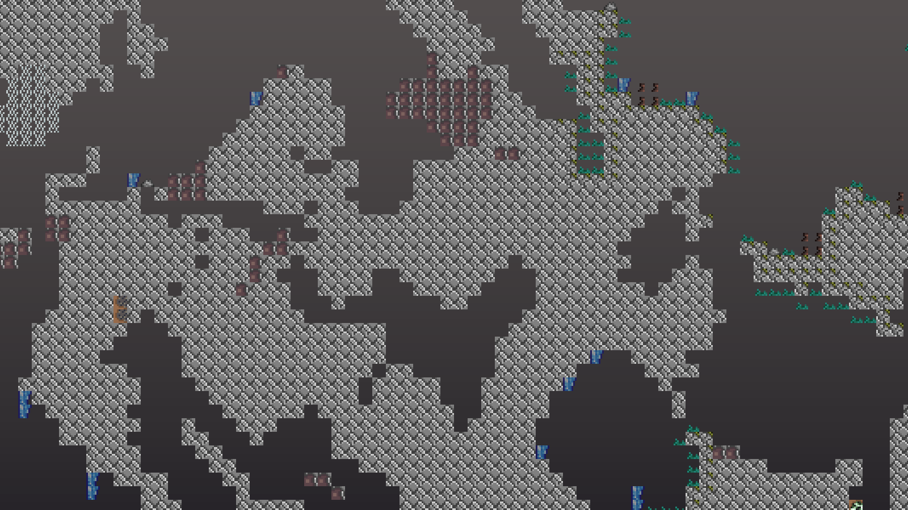
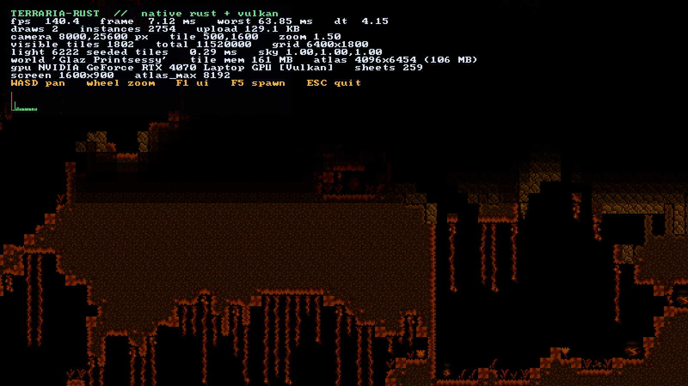
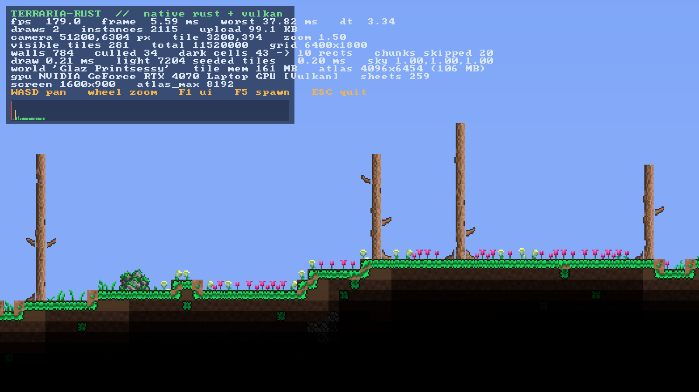

# Terraria-Rust

A native reimplementation of Terraria 1.4.5.8 in Rust with a Vulkan renderer, built from a
clean-room analysis of the decompiled C# game.

> **Status: milestone 1 — visual fidelity in progress.** This is *not* a playable game yet. It
> loads a real `.wld` world, extracts the original textures from the game's `.xnb` files, and
> renders the tile grid with a single instanced draw call on Vulkan at 500+ FPS, autotiled and
> lit by a port of the game's own light engine. Gameplay systems (player, items, NPCs, liquids,
> UI) are not implemented. See [`docs/ROADMAP.md`](docs/ROADMAP.md) for the honest plan.


| | |
| --- | --- |
|  |  |
| Night: the same `Main.SetBackColor` curve as the game | Underground: only lava and glow light the cave |
|  |  |
| Underworld: hell glow seed + lava | Debug overlay (F1) |

## What works right now

- **World loading** — native `.wld` parser (format versions ≥ 87, section table, RLE tile
  section, header metadata). A 6400×1800 world with 11.5 M tiles loads in ~60 ms.
- **Autotiling** — block frames from a port of `WorldGen.TileFrameCosmetic` (generic frame
  chain + merge families + 2 228 merge pairs extracted from the decompiled source) and wall
  frames from `Framing.WallFrame` (full 20×3 lookup). 5.9 M tiles + 2.7 M walls framed in
  ~150 ms at load.
- **Lighting** — a port of `TileLightScanner` (surface / hell / wall / emissive / liquid
  seeds) and `LightMap.Blur` (2 passes × 4 directional sweeps, `0.91` air / `0.56` solid
  decay, `0.0185` cutoff) over the visible rect inflated by 28 tiles. Torches, glowing
  mushrooms, gem walls, lava, the underworld glow and daylight all come from the same tables
  the game uses. ~0.3–0.6 ms per frame for a 1600×900 view.
- **Sky & daylight** — `Main.SetBackColor` ported (day 0–54 000, night 0–32 400) producing
  `Main.ColorOfTheSkies`, then `ApplyColorOfTheSkiesToTiles` for surface sunlight. The sky
  itself is the game's own `Background_0.png` gradient; underground, each column fades into
  cave darkness anchored to its first solid tile.
- **Asset pipeline** — `tools/XnbExtract` decompresses the game's XNA v5 `.xnb` containers
  (LZX) and writes PNGs. 13 993 textures extracted, 15 100 of 15 123 files OK.
- **Atlas** — all sheets used by the current world are shelf-packed into one 4096×6454
  texture at startup (105 MB), nearest filtering, no mipmaps.
- **Renderer** — wgpu 30 on the **Vulkan** backend, one instanced-quad pipeline, one atlas,
  1–2 draw calls per frame (world + optional UI), ~1 600–2 700 instances for a 1600×900
  viewport.
- **Debug overlay** — FPS, frame graph, draw calls, instance counts, upload size, camera
  state, tile counts, light-seeded tiles and light-map time, memory, GPU/driver info.
- **Culling** — 64×64 chunk occupancy skips empty areas; walls under fully opaque blocks
  are not emitted; fully dark cells whose content is opaque collapse into greedy black
  rectangles. All of it is pixel-identical to drawing every tile.
- **Camera** — WASD/arrows pan, mouse wheel zoom, F5 respawn.
- **Headless tooling** — `TR_BENCH` (uncapped frame timing), `TR_SHOT` (deterministic
  screenshot without desktop capture), `TR_CAM`/`TR_ZOOM`, `TR_DAY`, `TR_LIGHT_AT`,
  `TR_SCAN_LIGHT`, `TR_ATLAS_DUMP`, `TR_STATS` (phase timings + culling counters), and
  `tools/pixel_diff.py` for pixel-exact before/after checks.

## Measured (RTX 4070 Laptop, Ryzen AI 9 365, 1600×900)

| Metric | Value |
| --- | --- |
| Frame time, avg (surface, zoom 1.5, overlay off) | **1.3–1.9 ms** (present-floor bound) |
| CPU tile + light (surface, zoom 1.5) | **0.22 ms** |
| CPU tile + light (cave, zoom 1.0) | 0.48 ms |
| Debug stress, zoom 0.25 (surface / cave) | 3.70 / 5.58 ms |
| Draw calls | 1 (world) or 2 (with UI) |
| Instances at real zoom (1.0–2.0) | 900–3 600 (was 1 600–5 800) |
| Instances at zoom 0.25 (surface / cave) | 23 200 / 44 356 (was 40 630 / 77 439) |
| Lighting (visible rect + 28) | 0.2–0.5 ms real zoom; 2.5–3.6 ms at 0.25 |
| World load | ~60 ms |
| Autotiling (5.9 M tiles + 2.7 M walls) | ~150 ms |
| Atlas build | ~60 ms + one-time opacity scan |

The present/compositor floor on the test laptop is ~1.10–1.33 ms and bimodal depending on
power/compositor state, so CPU-side `TR_STATS` numbers are the stable comparison at real zooms.

## What is *not* implemented (yet)

Liquids, players, items, NPCs, projectiles, world generation, UI/inventory, audio, networking,
save writing. Trees are drawn as bare trunks: the game composes canopies and branches from
separate `Tree_Tops_*`/`Tree_Branches_*` textures in `TileDrawing`, which is part of the
`TileObjectData` work. Lighting is flat per tile (the original interpolates four corner
values), and the following light sources are still missing: per-type frame-dependent lights,
sun/moon/star light, `Main.mouseTextColor` flicker, invisible blocks/walls, and the real
parallax + underground background layers. Details and estimates in
[`docs/ROADMAP.md`](docs/ROADMAP.md).

## Build & run

Requirements: Rust 1.89+, a Vulkan-capable GPU and driver, Windows (Linux should work but is
untested).

```powershell
# 1. decompile the game (once) — requires ilspycmd
ilspycmd "C:\Program Files (x86)\Steam\steamapps\common\Terraria\Terraria.exe" -p -o decompiled

# 2. extract textures (once) — .NET 10 SDK
dotnet build tools/XnbExtract -c Release
.\tools\XnbExtract\bin\Release\net10.0\XnbExtract.exe `
  "C:\Program Files (x86)\Steam\steamapps\common\Terraria\Content\Images" assets\Images

# 3. build and run (no argument = most recent world in Documents/My Games/Terraria/Worlds)
cargo run --release -p tr-app
cargo run --release -p tr-app -- "C:\path\to\world.wld"
```

### Environment variables

| Variable | Meaning |
| --- | --- |
| `TR_BACKEND=dx12\|gl` | Use a different wgpu backend (default `vulkan`) |
| `TR_DEBUG=0` | Hide the debug overlay |
| `TR_CAM=x,y` | Start camera at tile coordinates |
| `TR_ZOOM=1.5` | Initial zoom factor |
| `TR_BENCH=600` | Render 600 frames uncapped, print p50/p95/p99, exit |
| `TR_SHOT=out.png` | Save a screenshot and exit |
| `TR_SHOT_FRAME=25` | Frame at which the screenshot is taken |
| `TR_ATLAS_DUMP=atlas.png` | Dump the packed atlas |
| `TR_DAY=0.15` | Override the time of day (0 = midnight, 1 = noon) |
| `TR_LIGHT_AT=3200,402` | Log the computed light at one tile (tile coords) |
| `TR_SCAN_LIGHT=1` | Log the most self-lit 40×40 window (`TR_SCAN_Y=min,max` to restrict) |
| `TR_DUMP_TILES=1` | Log tile ids/frames around spawn (`TR_DUMP_X`, `TR_DUMP_Y`) |
| `TR_NO_WALLS=1` | Skip wall rendering (compare autotiling / wall layers) |
| `TR_CHECK_FRAMES=1` | Verify computed frames against the tileset bounds |
| `TR_STATS=1` | Log average light/draw time and culling counters every 120 frames |
| `TR_LATENCY=1` | Override `desired_maximum_frame_latency` (default 1) |

## Layout

```
crates/tr-core     world model, .wld parser, tile packing, autotiling, lighting, generated tile tables
crates/tr-render   wgpu device, atlas packer, instanced sprite renderer, WGSL shader
crates/tr-app      winit app, asset loading, camera, debug overlay, bench/screenshot
tools/XnbExtract   C# XNB (LZX/DXT) -> PNG extractor
tools/GenTileData  C# generator: TileID/Main/WorldGen tables -> crates/tr-core/src/tiledata.rs
decompiled/        ILSpy output of Terraria.exe (not redistributed)
assets/Images/     extracted textures (not redistributed)
```

## Legal

The decompiled sources and extracted textures are derived from a copy of Terraria you own and
are **not** part of the project's source. They are excluded by `.gitignore` and must not be
redistributed. This project is a personal engineering experiment and is not affiliated with
Re-Logic.
