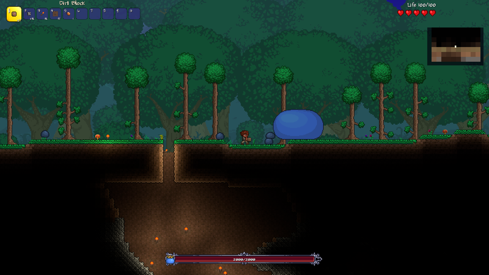
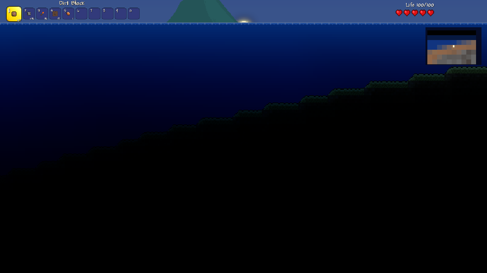
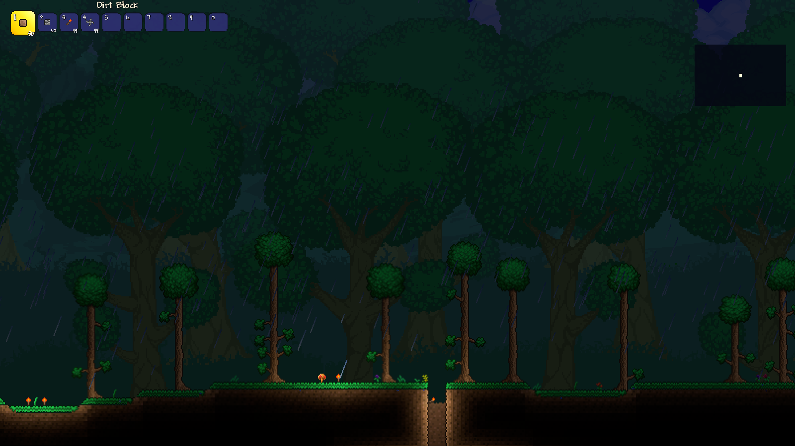

# Terrustaria

Terrustaria is a fan-made, from-scratch rebuild of **Terraria 1.4.5.8**. Think of it as the
same game with a different engine underneath: the same world, the same blocks, lighting,
water and physics, the same moment-to-moment feel — but written as a small, modern program
that runs comfortably on modest hardware. The aim is a faithful 1:1 match: same behaviour,
same pixels, different code.

It uses the game's own data (the `Content` folder from *your* copy of Terraria) and does not
ship any of it.

> **Where it stands today:** the world renders with the game's real lighting, liquids, trees,
> biome backgrounds and weather, and you can walk, mine, build, fight and even take on the
> first boss. It is very much a work in progress — see below for what is and is not there yet.


| | |
| --- | --- |
|  |  |
| A world from our own generator (seed 1) | The player, walking on the generated surface |
|  |  |
| Mining/placing with the hotbar and local re-framing | First enemy pass: hopping slimes and the health bar |
|  |  |
| Generated forest lake: vanilla draw cache, two-pass water | Snow biome: snow tiles, winter trees, pine background |
|  |  |
| Ocean beach at the world edge | Night: moon, stars, parallax mountains |
|  |  |
| Color mode: 9-sliced block light, smooth edges | Retro mode: flat per-tile legacy lighting |
|  |  |
| King Slime boss: 2000 HP, teleport and slime minions | Player HUD: breath meter when underwater |
|  |  |
| Storm: cloudAlpha ramp, lightning flashes, storm clouds | Underground hell: ash blocks, lava puddles, emerald light |
|  |  |
| Underground cave systems with natural lighting | Debug overlay: FPS, instance counts, light metrics |

## What you can already do

- **Explore a whole generated world** — rolling hills, caves, a forest lake, a snow biome in
  the east, a desert west of spawn, oceans at both edges and an ash-and-lava underworld at the
  very bottom.
- **See it lit the way the original is** — daylight and darkness, lamps, lava glow and cave
  shade, with the four switchable lighting styles (Color, White, Retro, Trippy). Press **F2**
  to cycle them.
- **Watch water and lava move** — breach a lake and it drains, streams level out, and
  waterfalls form at ledges. Breaking or placing a block wakes the neighbouring liquid.
- **Live through the weather** — rain, thunderstorms with lightning and dark storm clouds, and
  snowfall in the snow biome.
- **A full day/night cycle** — a sun, a moon, twinkling stars, drifting clouds and parallax
  mountain layers.
- **Move and build** — run, jump, swim, mine blocks and place them, with a ten-slot hotbar and
  item drops you can pick up.
- **Fight** — hopping slimes by day, zombies and demon eyes at night, and the first boss,
  **King Slime** (press **B** to summon it). There is a health bar, breath meter, coin purse
  and an overhead health bar on damaged enemies.
- **Hear it** — mining, placing, pickups, hits and music are played straight from the game's
  own sound files.
- **Poke at it** — a debug overlay (**F1**) and a free camera, plus the environment variables
  below for screenshots and benchmarks.

## Speed: how much faster it is now

Terrustaria went through a dedicated performance pass ("Milestone 1.5"), and the difference is
large. Every change was verified to produce the **exact same pixels** as before, so the game
looks identical — it just does far less work.

Measured on our test machine — an **RTX 4070 Laptop GPU with a Ryzen AI 9 365, at 1600×900** —
against the project's previous build:

- **Lighting in caves is roughly 2.5× faster**, and re-using the light map makes a still
  picture essentially free while smooth panning costs almost nothing.
- **Preparing the world's sprites (autotiling) went from ~295 ms to ~70 ms.**
- **Decoding the game's textures went from ~68 ms to ~20 ms.**
- **Start-up time roughly halved** (about 475 ms → 210 ms).
- A finished frame now sits around **1.3–2 ms** at 1600×900, drawing the whole scene in one or
  two GPU calls.

The important part: none of this came from cutting corners. The in-game zoom stays at the
original 1.0–2.0 range, no detail is ever dropped, and every optimisation was checked to be
pixel-for-pixel identical to the unoptimised version.

## Where your world is saved

Your world and character are saved to:

```
Documents/My Games/Terrustaria/Worlds/Terrustaria.trwld
```

The game loads that world on the next launch. The first time you run it, the world is
generated from a fixed seed; `TR_REGEN=1` regenerates it and `TR_SEED=<n>` picks a different
one.

## Environment variables

These mostly exist for screenshots, benchmarks and debugging — a normal player never needs
them. Set one before launching the program.

| Variable | Meaning |
| --- | --- |
| `TR_BACKEND=dx12\|gl` | Use a different wgpu backend (default `vulkan`) |
| `TR_DEBUG=0` | Hide the debug overlay |
| `TR_CAM=x,y` | Start camera at tile coordinates |
| `TR_ZOOM=1.5` | Initial zoom factor (gameplay range is 1.0–2.0) |
| `TR_DAY=0.15` | Override the time of day (0 = midnight, 1 = noon) |
| `TR_LIGHT_MODE=color\|white\|retro\|trippy` | Pin a lighting mode (F2 cycles in-game) |
| `TR_RAIN=0.75` | Force rain intensity (0..1.75) for screenshots |
| `TR_NO_WEATHER=1` | Start calm and disable the rain scheduler |
| `TR_BENCH=600` | Render 600 frames uncapped, print p50/p95/p99, exit |
| `TR_SHOT=out.png` | Save a screenshot and exit |
| `TR_SHOT_FRAME=25` | Frame at which the screenshot is taken |
| `TR_ATLAS_DUMP=atlas.png` | Dump the packed atlas |
| `TR_LIGHT_AT=3200,402` | Log the computed light at one tile (tile coords) |
| `TR_SCAN_LIGHT=1` | Log the most self-lit 40×40 window (`TR_SCAN_Y=min,max` to restrict) |
| `TR_SCAN_TORCH=1` | Log the densest 40×40 torch window (lighting screenshots) |
| `TR_SCAN_WATER=1` | Log the densest 40×40 liquid window (flow/liquid screenshots) |
| `TR_DUMP_TILES=1` | Log tile ids/slopes/frames around spawn (`TR_DUMP_X`, `TR_DUMP_Y`) |
| `TR_NO_WALLS=1` | Skip wall rendering (compare autotiling / wall layers) |
| `TR_NO_BG=1` | Skip the per-column cave background (A/B the sky composition) |
| `TR_CHECK_FRAMES=1` | Verify computed frames against the tileset bounds |
| `TR_STATS=1` | Log average light/draw time and culling counters every 120 frames |
| `TR_LATENCY=1` | Override `desired_maximum_frame_latency` (default 1) |
| `TR_NOCACHE=1` | Disable the light (D2) and world-range (G6) caches for A/B measurement |
| `TR_PAN=0.25` | Pan the camera this many tiles per frame (deterministic benchmarks) |
| `TR_REGEN=1` | Regenerate the default Terrustaria world |
| `TR_SEED=<n>` | Seed for `TR_REGEN` / first generation |
| `TR_NOPLAYER=1` | Hide and disable the player (free-camera A/B captures) |
| `TR_XY=x,y` | Spawn the player at a tile coordinate (camera follows) |
| `TR_THROW=1` | Throw one shuriken to the right at startup (projectile smoke test) |
| `TR_BOSS=1` | Spawn King Slime near the player at startup |
| `TR_COINS=123456` | Set the coin purse (HUD screenshot) |
| `TR_BREAK=x,y` | Headless test: break that tile on the first frame |
| `TR_PLACE=x,y,kind` | Headless test: place `kind` at that tile on the first frame |

## Building it yourself

Terrustaria ships **none** of Terraria's art, sound or data. To build and run it you must own
Terraria.

1. Create a folder called `assets` in the project root.
2. Copy the game's `Content` folder into it, so the result is `assets\Content` (i.e.
   `*\assets\Content`).
3. With the Rust toolchain installed, build and start it:

```powershell
cargo run --release -p tr-app
```

Nothing inside `assets\Content` is ever committed or uploaded — the repository ignores it, and
neither the decompiled code nor the extracted textures are part of this project.

## What is *not* implemented yet

Terrustaria is an ongoing effort, not a finished game. Still to come: the full item list
(tools, weapons, potions), the proper inventory/crafting/chest screens, the complete NPC and
projectile rosters, most of the UI, and networking. Biomes beyond forest, snow and a small
desert, world structures and dungeons, hardmode, and many background variants are still
missing. The world generator is a faithful but compact model of the original's shapes, and
several background/lighting details are approximations. See
[`docs/ROADMAP.md`](docs/ROADMAP.md) for the honest, detailed plan.

## Project layout

```
crates/tr-core     world model, save/load, world generation, autotiling, lighting, liquids
crates/tr-render   the GPU renderer (wgpu/Vulkan): atlas packing and the instanced sprite pipeline
crates/tr-app      the game itself: window, input, camera, player, drawing, HUD, debug overlay
tools/XnbExtract   converts the game's .xnb textures to PNG (run locally)
tools/GenTileData  generates the Rust tile tables from the game's data
assets/Content     your own licensed copy of the game's data (never redistributed)
```

## Legal

This is a personal, non-commercial fan project and a hobby. **All Terraria code, art, sounds,
names and every other asset belong to their original authors — Re-Logic and the people who
made Terraria.** Everything rights-wise stays with them. This project is not affiliated with,
approved by, or endorsed by Re-Logic in any way.

It exists for a single reason: as a free, public creation for players whose computers cannot
comfortably run the normal game, and as a learning project for its author. No game resources
are distributed here. The decompiled game source and the extracted textures are derived from a
copy of Terraria that you own, they stay on your machine, and they are never published.

## Licence and author

**[MIT](LICENSE)**, for this project's own original work only. Dependencies keep their own licences.
Terraria is a trademark of Re-Logic; Terraria's code and assets belong to Re-Logic and are
covered by the Terraria EULA. Decompiled game source and prepared resources stay on your
machine and are never published.

The Rust libraries this project is built on keep their own licences; see `Cargo.toml` for the
full list.

**Author**

Made by **DreadLord025** (@DreadLord025).
